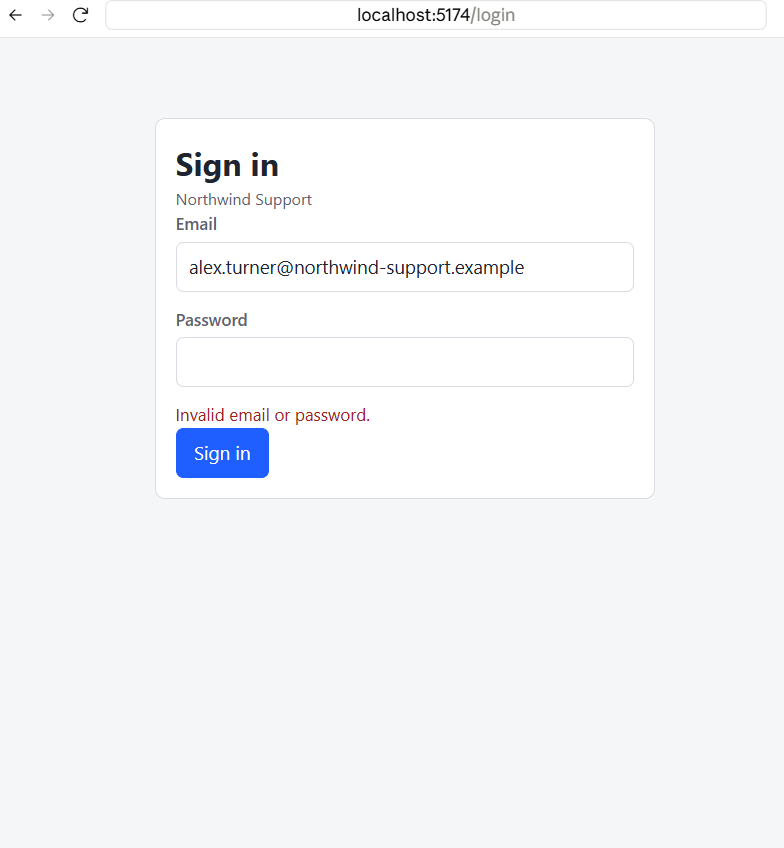
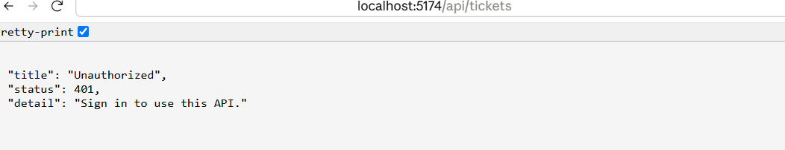
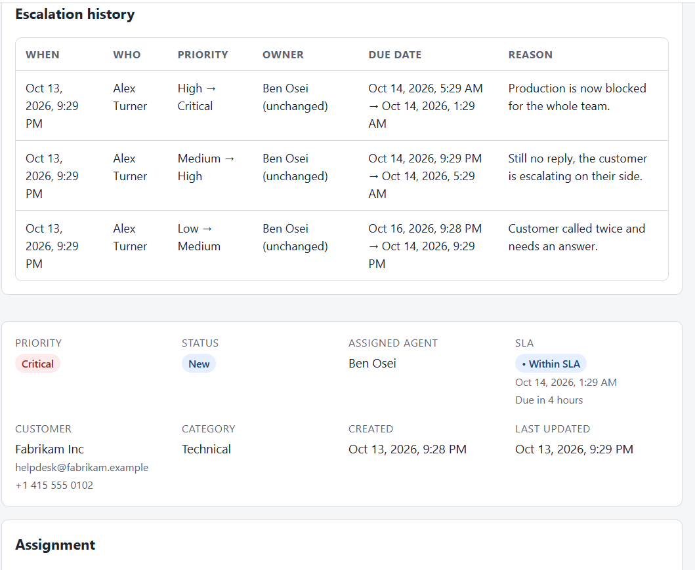
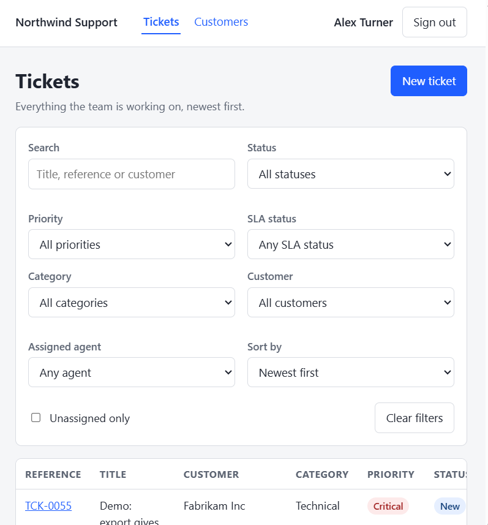

# Task 3: signing in

**In short:** agents sign in with an email and a password and get a token that lasts an hour. Every
endpoint except login now refuses a request without a valid token, and the escalation history records the
agent the token belongs to instead of a name typed into a box.

## What it looked like before

Anyone who could reach the API could use it. A request with no token was answered like any other:

```
GET /api/tickets  ->  200
```

and the escalation form asked "Escalated by", so the history could say anything.

## What I built

| Part | Choice |
| --- | --- |
| Credentials | A nullable `PasswordHash` column on `Agents` (migration `AddAgentPasswordHash`). Every user is an agent and there are no roles, so a separate users table would have been a second place to keep the same person |
| Hashing | ASP.NET Identity's `PasswordHasher`: PBKDF2 with a random salt and an iteration count stored in the hash, behind an `IPasswordHasher` interface in the application layer |
| Token | A JWT signed with HMAC-SHA256, valid for 60 minutes, carrying the agent's id, name and email. No refresh token: when it expires the agent signs in again |
| Signing key | From configuration (`Jwt:SigningKey`, or the `Jwt__SigningKey` environment variable). At least 32 bytes, checked at start-up: the app refuses to start without one |
| Protecting endpoints | One fallback authorization policy that requires a signed-in user, so a new endpoint is closed by default. Only `POST /api/auth/login` is marked `[AllowAnonymous]` |
| Who did it | `ICurrentUser` reads the agent id from the token. Escalation takes the actor from there; the request body no longer has an `escalatedBy` |
| Web | `/login` page, a route guard on everything else, the token in `sessionStorage`, sent as `Authorization: Bearer` by `api/client.ts` |

### Signing in

`POST /api/auth/login` takes `{ email, password }` and returns the token, when it expires and who it is for.
Four different mistakes get the same answer, a `401` with the message `Invalid email or password.`:

- an email that does not exist,
- a wrong password,
- an agent who is inactive (even with the right password),
- an agent who has no password set.

The answer does not say which half was wrong, so the endpoint cannot be used to find out which emails are
registered. For an unknown email the handler still checks the password against a dummy hash, so it does
not answer noticeably faster than for a real one.



`GET /api/auth/me` returns the agent the token belongs to and checks they are still active, so a token
for an agent who has since been deactivated stops working there.

### Checking the token

Every request is checked for the signature, the issuer, the audience and the expiry (with 30 seconds of
clock difference allowed). A token signed with a different key, an expired token and a token with one
character changed all end in the same `401` as no token at all.



I ran the same calls with curl against the running API:

| Call | Result |
| --- | --- |
| `GET /api/tickets`, no token | `401`, `Sign in to use this API.` |
| `POST /api/auth/login`, right credentials | `200`, token, expiry and `Alex Turner` |
| `GET /api/tickets` with `Authorization: Bearer <token>` | `200` |
| `POST /api/auth/login`, wrong password | `401`, `Invalid email or password.` |

The fallback policy covers all eleven endpoints; I called each one without a token to check. The Swagger
page stays open and has a Bearer scheme, so the token can be pasted in and the API tried from there.

### Who escalated

The escalation request is now just `{ "reason": "..." }`. The handler takes the agent's name from the
token and stores it in the history row, as it did when it was typed. It is a copy, so a later rename does not
rewrite old history. Sending an `escalatedBy` in the body does nothing. In the web app the form no longer asks; it says who it will be
recorded as.



## The web app

- **Guard.** Every page except `/login` is behind `RequireAuth`. Opening `/tickets/55` while signed out
  goes to `/login`, and after signing in returns to `/tickets/55`. The return address is only followed if
  it is a page of this app (not `//other.site` and not `/login` again).
- **Session.** One small store (`sessionStore`) holds the session, React reads it with
  `useSyncExternalStore`, and it ends by itself when the token expires.
- **A 401 ends the session.** If the API refuses a token the app had sent, the session is cleared and the
  guard sends the agent to the login page. A failed *login* does not do this, it just shows the message.
- **The form.** Labelled fields, a message under each, "Signing in..." while waiting, the password box is
  emptied after a refusal, and the same `Invalid email or password.` text as the API.
- **Header.** The signed-in name and a Sign out button.



### Where the token is kept

In `sessionStorage`. It lives for the tab and is gone when the tab closes, and other tabs do not share it.
The cost is that any script running on the page can read it, so a cross-site scripting bug would leak it.
`localStorage` is no safer and would keep the token after the browser is closed. An `httpOnly` cookie hides
the token from scripts, but needs the server to set it and protection against cross-site request forgery,
which is more than this app needs. A real deployment that handles anything sensitive should make that
change; it is listed under limitations.

## Development credentials

The development seed gives every active agent the same clearly-local password, hashed when it is seeded.
It is never returned by the API, and the seeder (which only runs when `Database:MigrateAndSeed` is on) is the only thing that sets it.

| | |
| --- | --- |
| Email | `alex.turner@northwind-support.example` (any active seeded agent works) |
| Password | `LocalDevOnly-Password-1` |

Yuki is seeded as inactive and cannot sign in. The signing key for local runs is in
`appsettings.Development.json` and is not a secret; anywhere else it must be set in the environment (it is
listed in `.env.example`).

## Database

One new nullable column, `Agents.PasswordHash`, from the `AddAgentPasswordHash` migration. It is nullable so
that an agent with no password can exist, and they cannot sign in. Email lookup uses the existing unique
index on `Agents.Email`, so no new index was needed.

## How I checked it

- **Backend:** 327 unit tests and 4 architecture tests. They cover the hasher (right password, wrong
  password, a different hash each time), the login rules for all four refusals, the token's claims and
  expiry, the settings validator refusing a missing or short key, and `WebApplicationFactory` tests that
  call the real pipeline: every endpoint is `401` without a token and works with one, a wrong-key and an
  expired token are `401`, and an escalation is recorded against the token's agent.
- **Web:** 133 tests. They cover the redirect and the return to the wanted page, the token being sent, a 401
  clearing the session, the login form's messages, and the session store (expiry, bad stored data,
  unavailable storage).
- **By hand:** in the browser: signing in and out, wrong and unknown credentials, an inactive agent, an empty
  form, a tampered token, opening a page while signed out and coming back to it. Against the API: the
  table above, the start-up refusal with a missing or short key, and a log check that no token or password
  is written.

## Limitations

- The token cannot be taken back before it expires; for 60 minutes a deactivated agent's token still works
  on endpoints other than `/me`. Short life is the mitigation. A revocation list or a short life with a
  refresh token would be the next step.
- There is no limit on failed sign-in attempts. A real deployment needs lockout or throttling.
- The token is in `sessionStorage`, see above.
- One password for every seeded agent is fine for development and wrong for anything else.
- No roles: any signed-in agent can do everything.
