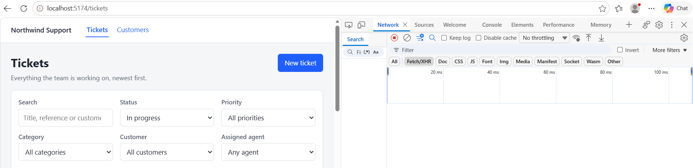
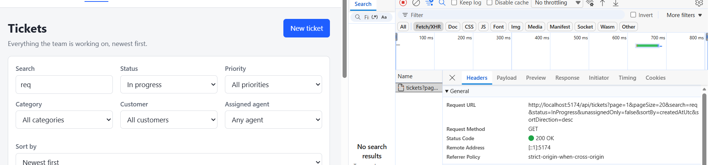
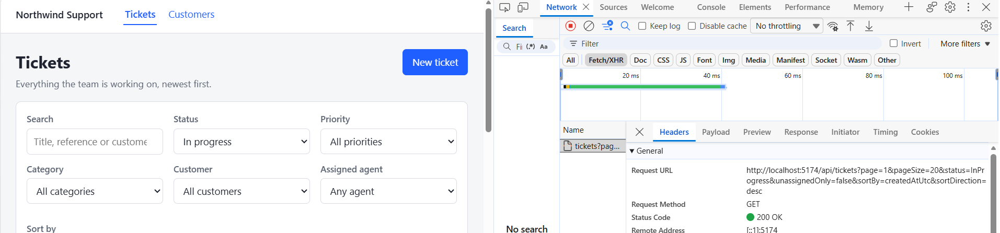

# DEFECT-117: ticket filters sometimes do not take effect

**Root cause:** the `useEffect` that loads tickets in `useTicketList` depended only on `search`, `page`
and `pageSize`. Changing any other filter updated the state but never triggered a request, and the
next search request then carried the earlier filters. An `eslint-disable` comment hid the missing
dependency.

## What was reported

On the ticket list, changing Status to *In progress* sends no request to `GET /api/tickets`. Typing in
the search box then sends a request that includes the earlier status, and clearing the search makes it
stale again.

## Reproducing it

I ran the app on the unchanged code, opened DevTools, went to the Network tab, filtered for `tickets`
(Fetch/XHR) and cleared the log. Then I changed Status to *In progress* on page 1.



The dropdown shows *In progress* and no request was sent. So the server was not ignoring the filter:
the request never left the browser.

Then I typed `req` in the search box:



This time a request went out, and its URL already contained `status=InProgress`
(`...search=req&status=InProgress&unassignedOnly=false...`). The status had been stored correctly. It
was only sent because the search change happened to trigger a fetch.

## Finding the cause

The value was stored, so I followed it from the dropdown through `TicketFilters.tsx`,
`TicketListPage.tsx` and `updateFilters` in `useTicketList.ts`. Every step updated the state, so the
fault had to be in whatever decides when to load:

```ts
useEffect(() => {
  const handle = window.setTimeout(load, DEBOUNCE_MS);

  return () => window.clearTimeout(handle);
  // eslint-disable-next-line react-hooks/exhaustive-deps -- filters object identity changes every render
}, [filters.search, filters.page, filters.pageSize]);
```

Three of the eleven filter fields were in the dependency array. Status, priority, category, customer,
assigned agent, unassigned-only and the sort order were not, so changing them did not re-run the effect.

`load` is also recreated on every render and reads `filters` from that render. The effect only runs when
one of the three listed values changes, and it then calls the `load` from the render that created it. That
is why the search request carried the status: by then the effect was created from a render in which the
status was already set.

### Why it was intermittent

`updateFilters` always resets `page` to 1 (`page: patch.page ?? 1`), and `page` was a dependency. On page 2
or later, changing a filter moved the page back to 1, the effect ran, and the filter appeared to work. On
page 1 the page did not change, so nothing ran.

### The suppressed warning

The `eslint-disable` comment hid exactly this. With the comment removed, ESLint reports:

```text
49:6  warning  React Hook useEffect has a missing dependency: 'load'. Either include it or remove the
dependency array  react-hooks/exhaustive-deps
```

The suggestion to add `load` to the array would have been wrong. `load` is a new function on every render and
it changes state, so the effect would run again after every render, in a loop. The comment's justification
("filters object identity changes every render") was also wrong: `filters` is state and only changes when
`setFilters` is called.

## The fix

I did not patch the dependency array. I changed how the list decides what to load:

- The hook keeps one object, the **applied filters**. The request is always made for that object, through
  the existing `useAsyncData` hook, so there is no hand-written dependency array left to get wrong.
- Dropdowns, the unassigned-only checkbox, sorting and paging update the applied filters straight away, so
  they send a request immediately.
- The text in the search box is kept separately. It is copied into the applied filters 300 ms after typing
  stops, so a burst of keystrokes sends one request, and that request includes the latest filters.
- "Clear filters" also cancels a search that was waiting to be sent.

A filter added later, such as the SLA status filter in Task 2, only has to be added to `TicketFilters`: any
change to the applied filters loads the list, with no extra wiring in the hook.

The fix is in `apps/web/src/features/tickets/hooks/useTicketList.ts`. I also removed the lint suppression.

## How I verified it

The regression tests in `useTicketList.test.ts` assert the arguments of the request that is sent. They use
fake timers and advance time by 0 ms for the immediate cases, so a request that only appeared after the
debounce would fail.

| What is tested | Original hook | Fixed hook |
| --- | --- | --- |
| Status, priority, category, customer, assigned agent, unassigned-only and sort each send a request straight away (7 tests) | fail | pass |
| Changing the page sends a request straight away | fail | pass |
| A filter change goes back to page 1 | fail | pass |
| A search after a status change sends both | pass | pass |
| Clearing the search keeps the status | pass | pass |
| A burst of keystrokes sends one request | pass | pass |
| Typed text shows straight away, before the request | pass | pass |
| A search change goes back to page 1 | pass | pass |
| Clear filters sends a request with everything cleared, and drops a pending search | pass | pass |

With the original hook, 9 of the 17 tests fail. With the fix all 17 pass. The ones that pass on both
describe behaviour that was already right (the search debounce and the reset), and they stop the fix from
breaking it.

I also checked it in the browser. With the log cleared, changing Status to *In progress* now sends the
request immediately, with `status=InProgress` in the URL:



## Limitation

Out-of-order responses are not handled by this change. A slow earlier request can still finish after a newer
one and overwrite its results. That is a separate problem from this defect.

## Lesson

Do not silence `react-hooks/exhaustive-deps` without understanding why it fires. Here the warning was
pointing at the real bug.
