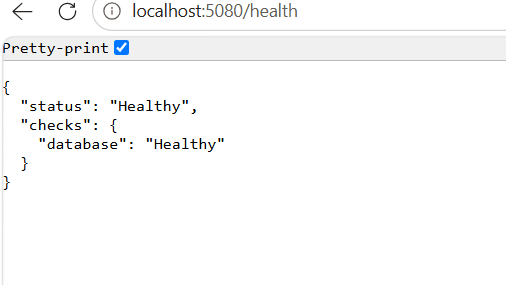
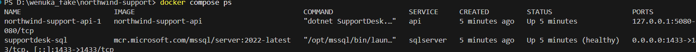
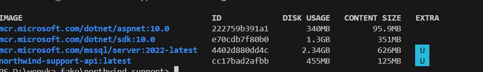
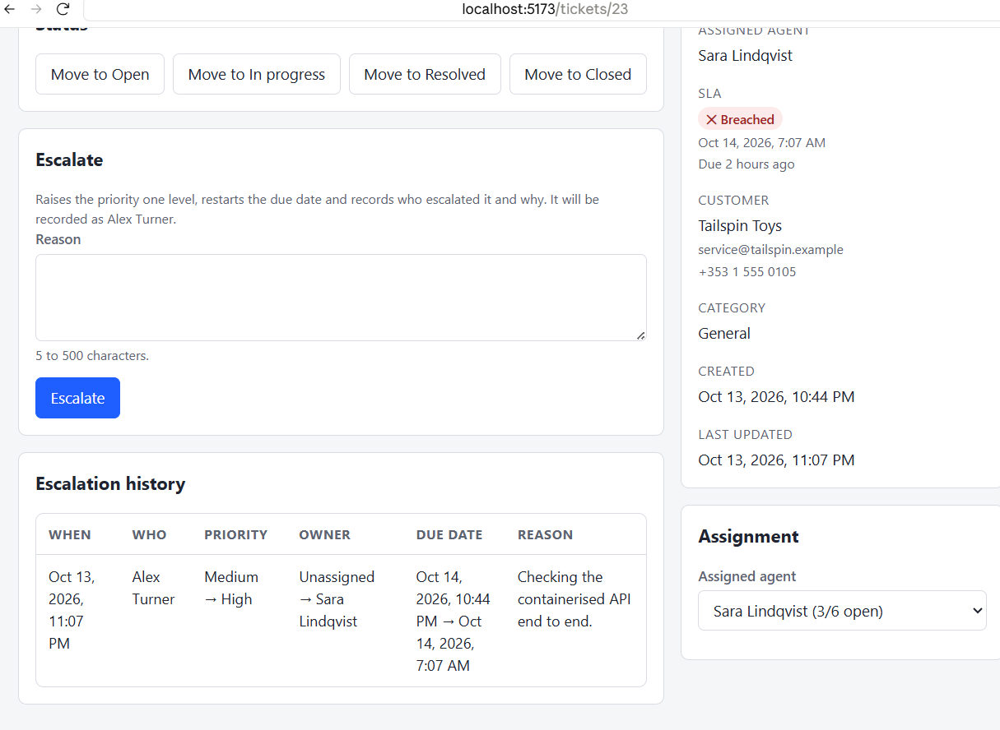

# Task 4: running the API in Docker

**In short:** the API now builds into an image and `docker compose up --build` starts SQL Server and the
API together. The image holds no configuration, runs as a user that is not root, and on an empty volume
the API creates its own database and demo data.

## Running it

```bash
docker compose up --build        # SQL Server, then the API
```

| What | Where |
| --- | --- |
| API | http://localhost:5080 (published on `127.0.0.1` only) |
| Health | http://localhost:5080/health |
| Web app against the container | `VITE_API_PROXY_TARGET=http://localhost:5080 npm run web`, then http://localhost:5173 |

The image can also be built by hand. The build context is the repository root, because the shared build
files (`Directory.Build.props`, `Directory.Packages.props`, `global.json`) live there:

```bash
docker build -f apps/api/Dockerfile -t northwind-api .
```

## What is in the image

| Brief | What I did |
| --- | --- |
| DK-1 multi-stage, cached restore | Stage 1 is the .NET 10 SDK, stage 2 is the ASP.NET 10 runtime. Stage 1 first copies only `global.json`, the two `Directory.*.props` files and the four `.csproj` files and runs `dotnet restore`. The source is copied after that, so editing a `.cs` file does not redo the restore |
| DK-2 `.dockerignore` | `bin/`, `obj/`, `node_modules/`, `.git/`, `.env` and the web app, plus tests, docs, the Development settings file and editor folders, so the build context stays small |
| DK-3 non-root, 8080, no certificates | `USER $APP_UID` (the runtime image's built-in `app` user), `ASPNETCORE_URLS=http://+:8080`, no certificate anywhere. TLS is ended in front of the container in a real deployment |
| DK-4 nothing baked in | The image sets no connection string, key or environment name. The only configuration file inside is `appsettings.json` (SLA windows, token lifetime, issuer), which has no secret; `appsettings.Development.json` is kept out by `.dockerignore` |
| DK-5 compose service | `api` is built from the Dockerfile, published on `127.0.0.1:5080`, reaches SQL Server as `sqlserver` (not `localhost`, which inside the container is the API itself), and `depends_on` it with `condition: service_healthy` |
| DK-6 database ready with the API | `Database__MigrateAndSeed=true` in compose; see "Migrations" below |
| DK-7 `/health` | Added in the commit before this one: 200 or 503, open without a token, opened where it is mapped |
| DK-8 web app against the container | `VITE_API_PROXY_TARGET=http://localhost:5080 npm run web` (checked below) |

### Environment variables

| Variable | Used for | Default in compose |
| --- | --- | --- |
| `ConnectionStrings__Default` | SQL Server connection, host `sqlserver` | built from `MSSQL_SA_PASSWORD` |
| `Jwt__SigningKey` | Signs sign-in tokens (32 bytes at least; the API will not start without it) | `JWT_SIGNING_KEY`, else a local fixture that is not a secret |
| `ASPNETCORE_ENVIRONMENT` | The environment name | `ASPNETCORE_ENVIRONMENT_API`, else `Production` |
| `Database__MigrateAndSeed` | Apply migrations and seed on start | `true` |

All of them are in `.env.example`. The environment name has its own variable name
(`ASPNETCORE_ENVIRONMENT_API`) because `.env` also holds `ASPNETCORE_ENVIRONMENT=Development` for running
the API from source, and that must not turn the container into a Development one.

### Why the container runs as Production

The brief takes the environment name from the environment, so I chose the one that matches how the image
would be used. `Production` means no Swagger and no development signing key, and it proves the image works
with nothing but run-time configuration: the key and the connection string have to arrive from outside, or the
API refuses to start. The cost is that `appsettings.Development.json` is no longer there to help, which is
the point.

## Migrations

On `docker compose up` against an empty volume, the API applies its migrations and seeds the demo data when
it starts, because compose sets `Database__MigrateAndSeed=true`. The flag is its own setting and is off
unless set, so it does not depend on the environment being Development.

**In a real deployment I would not do this at start-up.** Migrations would run as their own step in the
release, for example an EF Core migration bundle (`dotnet ef migrations bundle`) run once before the new
version starts. The reasons:

- **Several copies.** When more than one API instance starts at the same time they all try to migrate, and
  they race. One deliberate step runs once.
- **Permissions.** The API's database login needs to read and write rows, not to change the schema. If the
  API migrates itself, its login can drop tables.
- **A failed migration stops the release, not the API.** With start-up migration a bad migration shows up
  as an instance that will not become healthy, in the middle of a rollout.
- **Seeding demo data** (including a known password for every agent) must never happen against a real
  database.

## How I checked it

### 1. A clean start ends healthy, with data

```
docker compose down -v
docker compose up --build -d
```

`down -v` removes the database volume, so this starts from nothing. Once the API is up:



```
GET  http://localhost:5080/health             -> 200 {"status":"Healthy","checks":{"database":"Healthy"}}
GET  http://localhost:5080/api/tickets        -> 401 (no token)
POST /api/auth/login, then GET /api/tickets   -> 200, totalCount 40
```



### 2. A code change reuses the restore layer

I added a comment line to `Ticket.cs`, rebuilt, and read the build log (then reverted the edit). All the
`COPY ...csproj` steps and `RUN dotnet restore` say `CACHED`; only `COPY apps/api/src` and
`RUN dotnet publish` ran again.

### 3. Image size

| Image | Size on disk | Compressed |
| --- | --- | --- |
| `mcr.microsoft.com/dotnet/sdk:10.0` | 1.3 GB | 351 MB |
| `mcr.microsoft.com/dotnet/aspnet:10.0` (the base we run on) | 340 MB | 95.9 MB |
| `northwind-support-api` (ours) | **455 MB** | **125 MB** |

Our image is about a third of the size of the SDK image. The runtime base is 340 MB and the application adds
about 115 MB on top of it.



### 4. Not root

```
docker compose exec api whoami   ->  app
docker compose exec api id       ->  uid=1654(app) gid=1654(app)
```


### 5. Nothing secret in the image

`docker history --no-trunc` has no password or key in any layer. `docker image inspect` shows only the
base image's variables plus `ASPNETCORE_URLS`, and `ls /app` shows `appsettings.json` and no Development file.

### 6. The web app against the container

I stopped the local API, started the web app with `VITE_API_PROXY_TARGET=http://localhost:5080 npm run web`,
signed in as the development agent and escalated a ticket. It worked end to end and the history recorded
the signed-in agent:



## Limitations

- **No HTTPS in the container,** as asked. TLS belongs in front of it (a load balancer or reverse proxy).
- **The image has no `HEALTHCHECK`,** because the runtime image has no `curl` to call `/health` with.
  Compose only waits for SQL Server; the API reports itself through `/health`.
- **Migrate-and-seed on start is for local use.** See "Migrations".
- **The compose signing key and SQL password are local fixtures.** A real environment passes its own.
- **One architecture, no registry push and no CI,** all out of scope.
