# Task 2: triage, escalation and SLA status

**In short:** a new ticket now gets its priority, due date and owner from rules instead of from a team
lead, and the response says why. A ticket can be escalated one level with a reason, and every escalation
is kept. SLA status is worked out from the dates and is never stored, and the list can be filtered by it.

## What it looked like before

I started by looking at what the app did with a Security ticket before I changed anything. In Postman I
raised a ticket for Contoso (a Premium customer) in the Security category, asking for priority Low:

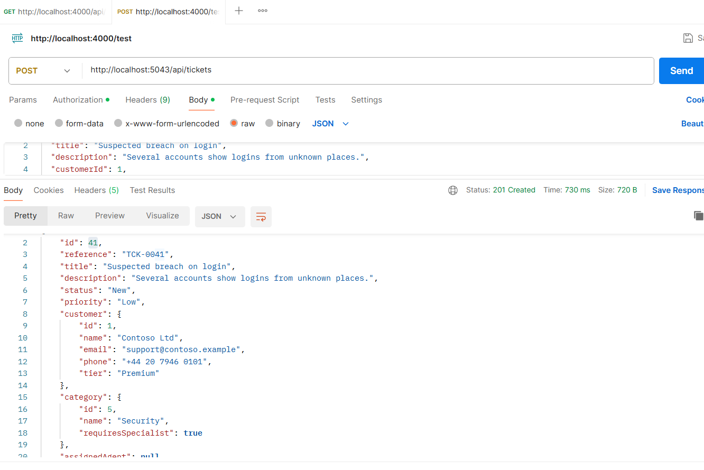

It came back as Low. Reading it back shows the rest: no agent, no due date, and an SLA of
`NotApplicable`:

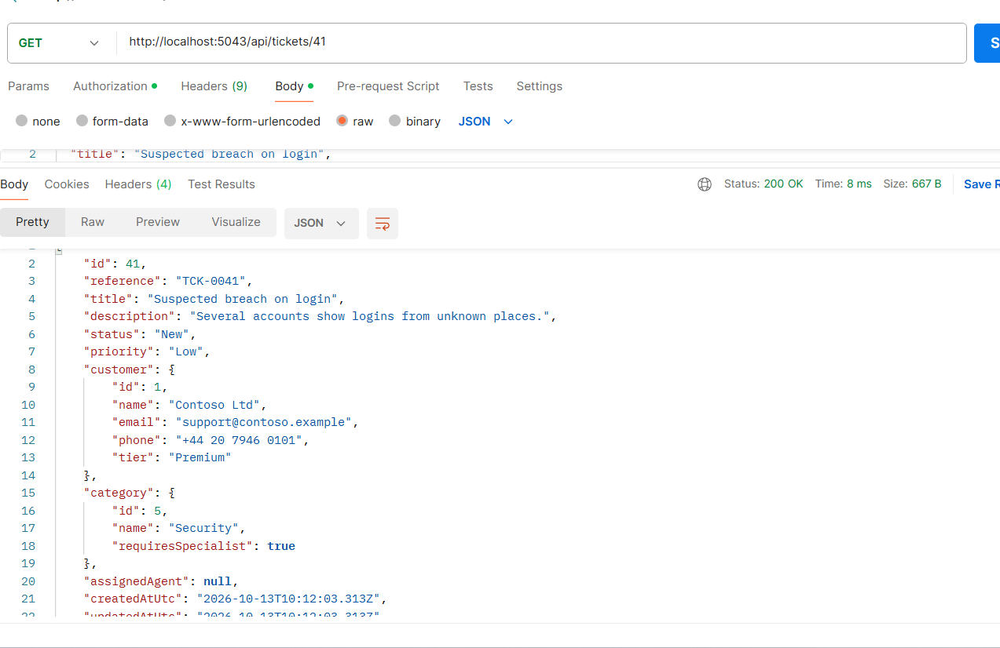

So a Security ticket could sit at Low with nobody on it and no deadline.

## The rules as I understood them

| Rule | What I built |
| --- | --- |
| Priority (BR-1) | The requested one, Medium if none. A category flagged `ForcesCriticalPriority` is always Critical |
| Window and due date (BR-2, BR-3) | Start plus a window: Critical 4 h, High 8 h, Medium 24 h, Low 72 h. Premium gets half, never under 1 hour |
| Owner (BR-4, BR-5) | Active agents strictly below their limit. A `RequiresSpecialist` category needs the specialization. Fewest open tickets wins, lowest id on a tie. If nobody fits, the ticket is created unassigned and says why |
| Configuration (BR-6) | The windows, the multiplier, the floor and the threshold come from the `Sla` section. No category name appears in code |
| Escalation (BR-7) | One level up, due date restarted from now, owner kept if still eligible, history row written. Critical, Resolved and Closed are refused |
| SLA status (BR-8) | Worked out from the due date, the resolution time and an injected "now" |

A few things the brief left open, so I decided:

- **"25% or less" includes the line.** Exactly a quarter of the window left is At risk.
- **The window for "25%" is the policy window for the priority and tier,** not due date minus created
  date. After an escalation the due date is restarted, so created-to-due would be the wrong window. The
  cost is that changing the `Sla` section, or a customer's tier, changes the status of tickets that
  already exist.
- **The escalated ticket does not count against its own agent's limit.** Otherwise an agent at 6 of 6
  would lose every ticket they already hold when one is escalated.
- **Ties go to the lowest agent id,** so the same input always gives the same answer.
- **After an escalation, nobody eligible leaves the ticket unassigned** and the history shows it.
- **The `Sla` section moved to `appsettings.json`** from `appsettings.Development.json`, so it is also in
  the Docker image, which will not have the Development file.

## Where each rule lives

The point of the task was where the rules go, so none of them is in a controller or a handler.

| Rule | Where |
| --- | --- |
| Windows, multiplier, floor, threshold | `SlaPolicy` (domain), built from the `Sla` section at startup by `SlaPolicyFactory` |
| Priority | `PriorityResolver` |
| Owner | `AgentSelector` |
| Escalation and its history row | `Ticket.Escalate`, which returns an immutable `TicketEscalation` |
| SLA status | `SlaEvaluator` |
| Putting them together and explaining it | `TicketTriage` (application) |

Raising a ticket and escalating one both go through `TicketTriage`, so the windows, the priority and the
owner are worked out in exactly one way. The domain classes know nothing about the database or the web
layer, and an architecture test checks that.

## Triage on create

I raised the same ticket again: Contoso, Security, requested Low. It came out Critical, with Priya Nair
and a due date two hours out:

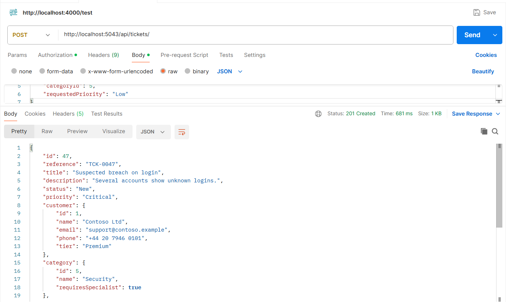

Security forces Critical, and a Premium customer gets half of the 4 hour window. Priya is a Security
specialist with fewer open tickets than the other one, who is full. The response carries a `triage` object
that says why:

```json
"triage": {
  "appliedPriority": "Critical",
  "priorityReason": "Category 'Security' is always treated as Critical",
  "slaWindowHours": 2,
  "slaReason": "Critical base window 4h, halved for a Premium customer",
  "assignmentReason": "Fewest open tickets among Security specialists"
}
```

When nobody can take the ticket the response is still `201`, with no agent and the reason. After enough
tickets had been raised for it, the web app showed exactly that:

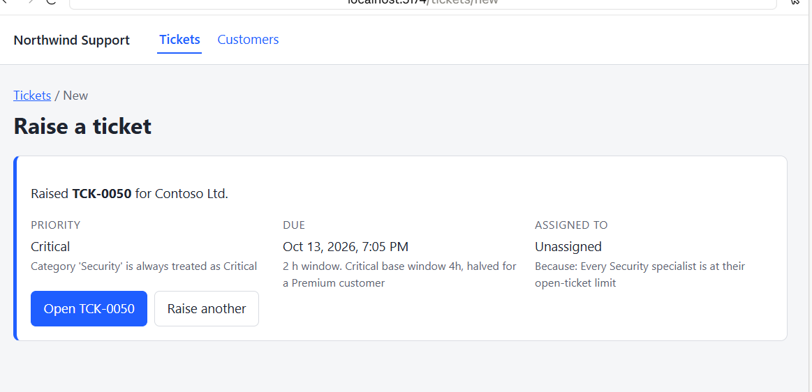

### The brief's worked examples

I checked each one against the seeded agents, in unit tests and against the running API:

| Input | Result | Owner |
| --- | --- | --- |
| Adventure Works (Premium), Outage, requested Medium | Critical, 2 h | Ben Osei |
| Contoso (Premium), Security, requested Low | Critical, 2 h | Priya Nair |
| Fabrikam (Standard), Billing, requested High | High, 8 h | Sara Lindqvist |
| Tailspin (Standard), Technical, no priority | Medium, 24 h | Sara Lindqvist |
| Wide World (Premium), General, requested Low | Low, 36 h | Sara Lindqvist |
| A hypothetical 1 h Premium window | 1 h, not 30 minutes | n/a |
| A High ticket escalated at 14:00, Standard | Critical, due 18:00 | current agent if eligible |

The unit tests run these on the seeded counts. When I raised all five one after another on the live
database, the workloads had shifted (Sara had taken two tickets and tied with Ben), and the lowest-id
rule gave the Wide World ticket to Ben. That is the rule working, and not a different answer.

## Escalation

`POST /api/tickets/{id}/escalate` takes a reason and who is escalating. A reason under 5 or over 500
characters after trimming is a `400`. An unknown ticket is a `404`. A Critical, Resolved or Closed ticket
is a `409`, and the message says which. The ticket and the history row are saved in one `SaveChanges`.

A success returns the updated ticket and the history entry that was written. I escalated a Medium
ticket for Tailspin:

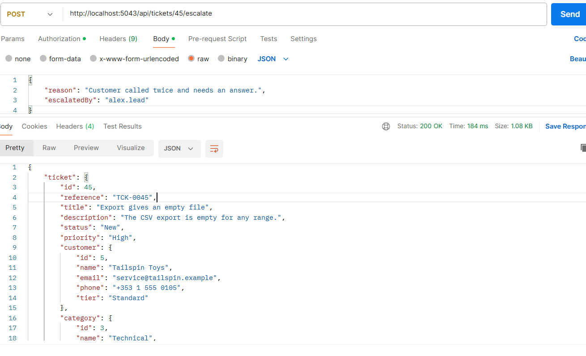

It went to High, and the due date moved to 8 hours from the escalation: the High window for a Standard
customer, worked out from the moment of escalation and not from creation. Sara Lindqvist kept the ticket
because she was still eligible. The refusals:

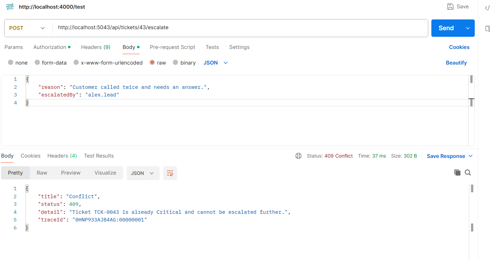

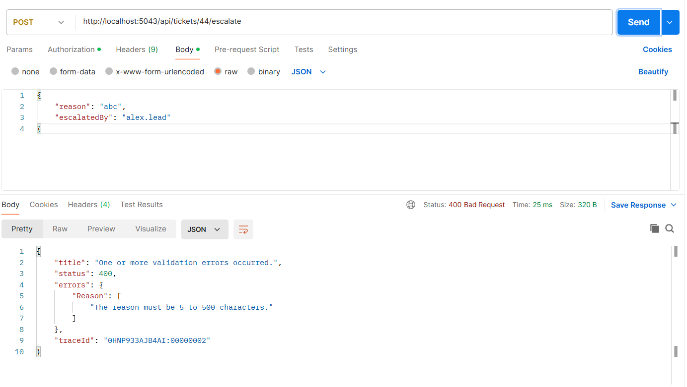

The `409` is `Ticket TCK-0043 is already Critical and cannot be escalated further.` A Resolved or Closed
ticket gets the same status with its own message, for example `Ticket TCK-0025 is Resolved and cannot be
escalated.`

The brief says `escalatedBy` comes from the request body until Task 3. In this task it does, as the screenshots show.
Task 3 then removed it: the request is now just `{ "reason": "..." }` and the agent comes from the token (see
[authentication.md](authentication.md)).

## History

`GET /api/tickets/{id}/escalations` returns the entries newest first, with the agent names joined in the
same query:

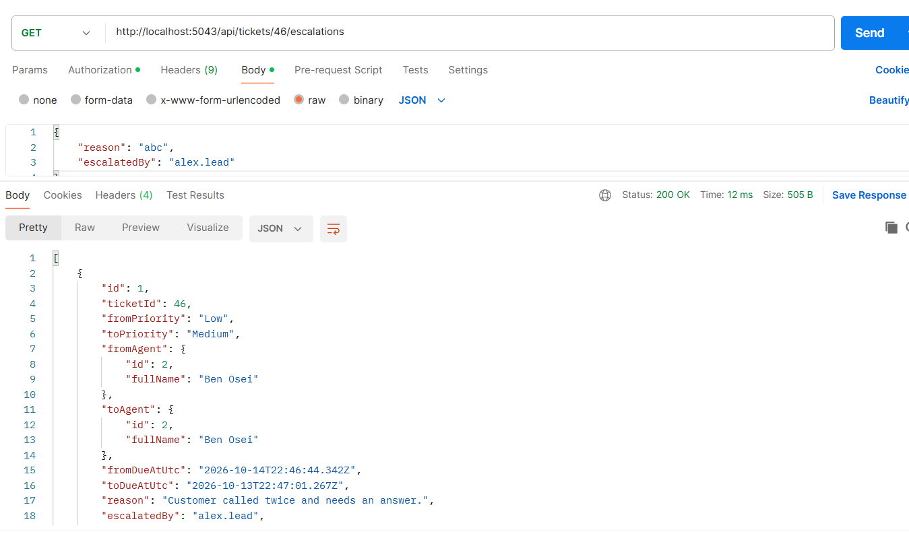

## SLA status and the filter

`?slaStatus=` takes `NotApplicable`, `WithinSla`, `AtRisk`, `Breached` or `Met`. It is one more step in
`ApplyFilters`, so the count, the sorting and the paging stay in SQL. A status that is not one of those
is a `400`.

The at-risk cut-off depends on the priority and the tier, because the window does. There are only eight
combinations, so each cut-off is worked out in C# once per request as a date, and SQL only compares
dates with those constants. No date arithmetic runs in SQL, which would differ between SQL Server and
SQLite. For `?slaStatus=Breached` the generated count is:

```sql
SELECT COUNT(*)
FROM [Tickets] AS [t]
INNER JOIN [Customers] AS [c] ON [t].[CustomerId] = [c].[Id]
INNER JOIN [Categories] AS [c0] ON [t].[CategoryId] = [c0].[Id]
LEFT JOIN [Agents] AS [a] ON [t].[AssignedAgentId] = [a].[Id]
WHERE [t].[DueAtUtc] IS NOT NULL
  AND (([t].[ResolvedAtUtc] IS NOT NULL AND [t].[ResolvedAtUtc] > [t].[DueAtUtc])
    OR ([t].[ResolvedAtUtc] IS NULL AND [t].[DueAtUtc] < @nowUtc))
```

and for `AtRisk` the `WHERE` has eight branches, one per priority and tier, each of the form
`[t].[Priority] = @priority AND [c].[Tier] = @tier AND [t].[DueAtUtc] <= @latestDueAtUtc`.

The status a row shows is worked out in C# and the filter in SQL, so the main test checks that they
never disagree: for every priority and tier, at times either side of every boundary, open and resolved
(about 580 tickets), each status filter selects exactly the rows that show that status, and the five
sets add up to the whole table. On the real SQL Server the five statuses came back as 1, 16, 1, 16 and
12 tickets, which is all 46, and every row had the status that was asked for.

## The screens

The SLA indicator is one component used by the list and the detail page. It shows the words and a symbol
as well as a colour, so the state is never carried by colour alone. The filter bar gets an SLA status
select that sends its request at once (the DEFECT-117 fix means a new filter needs no extra wiring):

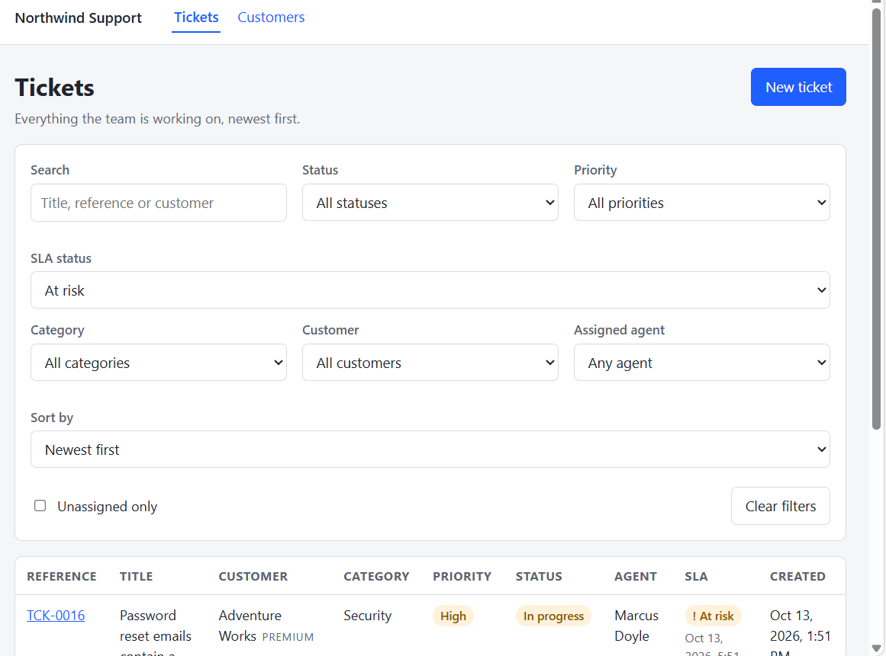

The escalation panel checks the same limits as the server before it calls the API, so an invalid reason
never leaves the browser:

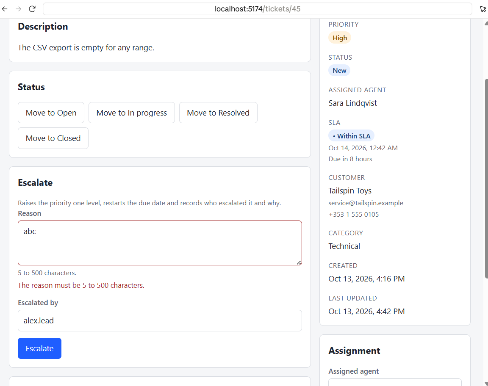

After an escalation the ticket and the history refresh without a reload:

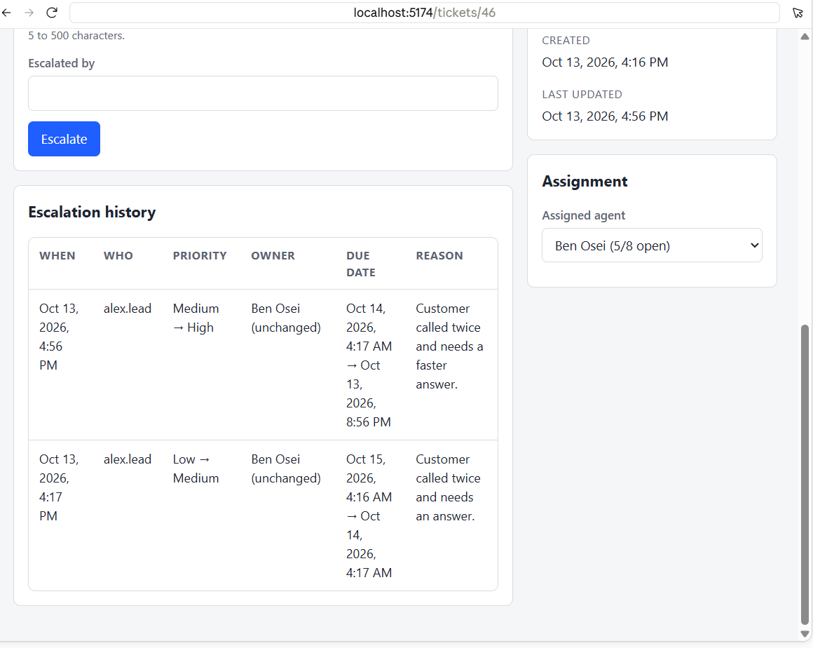

A ticket that cannot be escalated shows the reason instead of the form. The server is still asked if the
screen is out of date, and its refusal is shown:

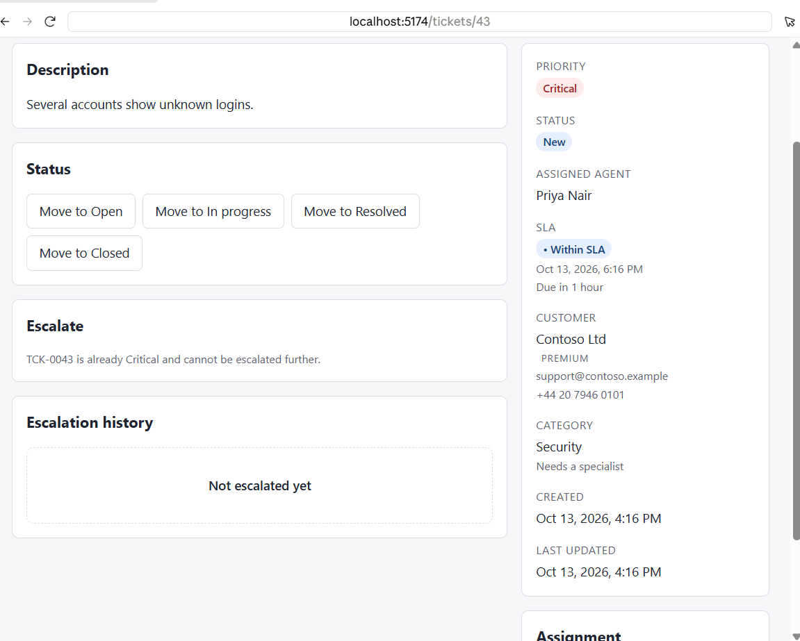

## Database

One new table, `TicketEscalations`, from the `AddTicketEscalations` migration. The agent and due-date
columns are nullable, because a ticket can have no owner or no due date. The reason is limited to 500
characters and the name to 100, both required. All three foreign keys are `Restrict`, so the history
cannot be deleted by accident: a test checks that a ticket or an agent named in it cannot be removed. I
applied the migrations to an empty database to check it builds from nothing.

The index on `(TicketId, EscalatedAtUtc DESC)` serves the only way the history is read, one ticket's
history newest first, and it also serves as the index on the ticket foreign key. EF added two more, on
`FromAgentId` and `ToAgentId`. Nothing queries them, but they make the foreign key check cheap if an
agent is ever changed, so I kept them.

## How I checked it

- **Backend:** 224 unit tests and 4 architecture tests. They cover the windows for every priority and tier
  with the floor, forced Critical, agent selection (fewest open, specialists, limits, inactive, ties,
  nobody eligible), escalation and its history row, the SLA status at the boundaries, and the SQLite
  persistence and queries.
- **Web:** 78 tests. They cover a short reason blocking submission without calling the API, a 409 being
  shown with the ticket unchanged, every SLA state rendering differently, the history and the triage
  result, and `slaStatus` reaching the query string.
- **By hand:** each status code against the running API in Postman, each screen above in a browser, and
  the generated SQL in the API console.

## Limitations

- Open-ticket counts are read and then used, so two tickets raised at the same moment could both go to
  an agent who has room for only one.
- Changing the `Sla` section or a customer's tier changes the status of tickets that already exist.
- When this task was written, who escalated was a text box the agent filled in, so it could be any name. Task 3
  fixed that by taking the name from the token.
