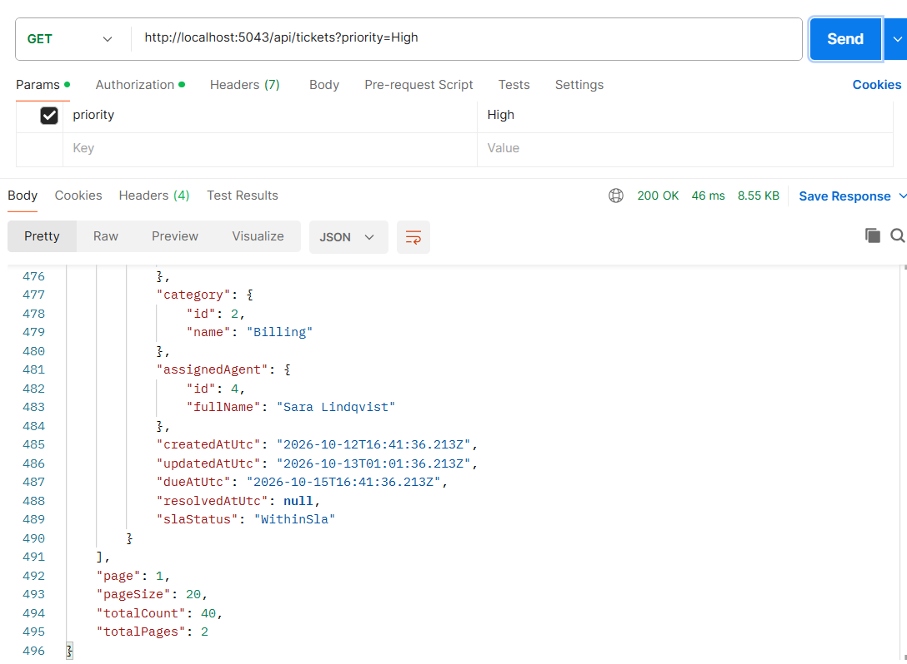
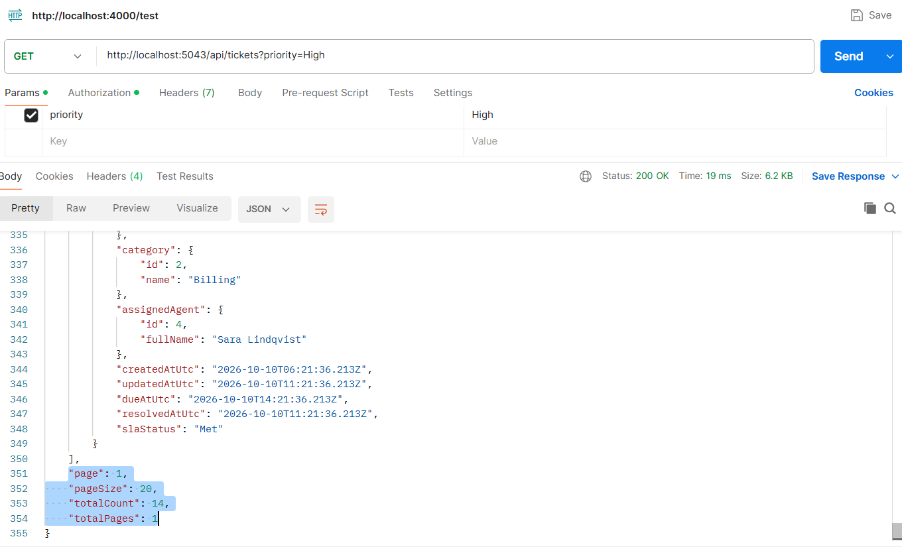

# Task 1.2: server-side filtering

**Summary:** the API bound the filter values into `TicketQuery` but never used them, so every request
returned all 40 tickets. The filters are now applied in the database, before the count and the paging, so
`totalCount`, `totalPages` and the pager describe the filtered set.

## Before

The web app already sent the filters, and the API ignored them. Asking for High priority tickets only
still returned everything:



The URL is `/api/tickets?priority=High` and the response says `"totalCount": 40` and `"totalPages": 2`,
which is every ticket in the seed.

## What I changed

The change is in `TicketQueries.GetPagedAsync` (Infrastructure). It used to count and page the whole list.
Now it narrows the list first:

```csharp
var tickets = ApplyFilters(TicketsWithLabels(), query);

var totalCount = await tickets.CountAsync(ct);
```

`ApplyFilters` adds one `Where` for each filter that was supplied:

| Parameter | Rule |
| --- | --- |
| `status`, `priority`, `categoryId`, `customerId`, `assignedAgentId` | Exact match (FL-1) |
| `unassignedOnly=true` | Only tickets with no assigned agent (FL-2) |
| `search` | Trimmed, ignored when blank, matches the title, the reference or the customer name (FL-3) |

Every filter is its own `Where`, so they all have to match (FL-4). The whole query is one LINQ expression
that EF Core turns into SQL, so nothing is filtered in C# (FL-5).

Two small points:

- `assignedAgentId` together with `unassignedOnly=true` matches nothing, because a ticket cannot be both.
  I left that as it is, since the filters are ANDed.
- I moved the `TicketWithLabels` helper class into its own file. It was a private class inside
  `TicketQueries`, and the SLA filter in Task 2 needs to use it too.

## After



The same request now returns `"totalCount": 14` and `"totalPages": 1`. The database dropped the other 26
tickets before counting.

## How I checked it

**Tests on a real database.** `TicketQueriesFilterTests` run the query against an in-memory SQLite
database, so a filter only passes if it really becomes SQL. A mocked repository would pass whatever the
query looked like. They cover the three cases the brief names (exact priority, a combination of filters, a
search on the customer name) and these:

- status, category, customer and assigned agent, each on its own;
- unassigned-only, and an agent together with unassigned-only matching nothing;
- search by title and by reference, a trimmed search, and a blank search (empty, spaces, null) being ignored;
- `%` and `_` in the search text treated as plain characters;
- count and pages for a filtered set (5 matches, page size 2, page 3 gives 1 item and 3 pages);
- a page past the end being empty while the count is still right.

Before I wrote the filtering, 16 of the 20 tests failed. The four that passed ("no filters" and the three
blank searches) describe behaviour that was already right. With the filtering all 20 pass.

**The SQL.** The API logs every SQL command in Development. For `?priority=High&search=TCK-0012` it ran
two statements, and the filter is in both:

```sql
SELECT COUNT(*)
FROM [Tickets] AS [t]
INNER JOIN [Customers] AS [c] ON [t].[CustomerId] = [c].[Id]
INNER JOIN [Categories] AS [c0] ON [t].[CategoryId] = [c0].[Id]
LEFT JOIN [Agents] AS [a] ON [t].[AssignedAgentId] = [a].[Id]
WHERE [t].[Priority] = @priority AND ([t].[Title] LIKE @search_contains ESCAPE N'\'
   OR [t].[Reference] LIKE @search_contains0 ESCAPE N'\'
   OR [c].[Name] LIKE @search_contains1 ESCAPE N'\')

-- the page query has the same FROM and WHERE, then:
ORDER BY [t].[CreatedAtUtc] DESC, [t].[Id] DESC
OFFSET @p ROWS FETCH NEXT @p6 ROWS ONLY
```

The `WHERE` comes before the count and before the `OFFSET`, which is what makes the count and the pager
right. EF Core also adds `ESCAPE N'\'` to the search, which is why `%` and `_` are matched literally.

**Against the real SQL Server.** I compared the API with a direct `COUNT(*)` in the database for the same
filters on the seed data, and they agree:

| Filter | API `totalCount` | Direct SQL count |
| --- | --- | --- |
| `priority=High` | 14 | 14 |
| `priority=High&status=InProgress` | 4 | 4 |
| `search=contoso` | 7 | 7 |
| `unassignedOnly=true` | 4 | 4 |
| `categoryId=2&customerId=1` | 2 | 2 |

## Adding the next filter

Add the field to `TicketQuery` and one more `if` block in `ApplyFilters`. The count, the sorting and the
paging need no change, because they all work on whatever `ApplyFilters` returns. The SLA status filter in
Task 2 is added this way.

## Limitations

- `Contains` is case-insensitive on SQL Server because of its default collation, but SQLite (used in the
  tests) is case-sensitive, so the search tests use the exact case of the data.
- The search is `LIKE '%text%'`, which cannot use an index. That is fine for a few hundred tickets. For a
  very large table it would need full-text search, or a prefix match on the reference.
